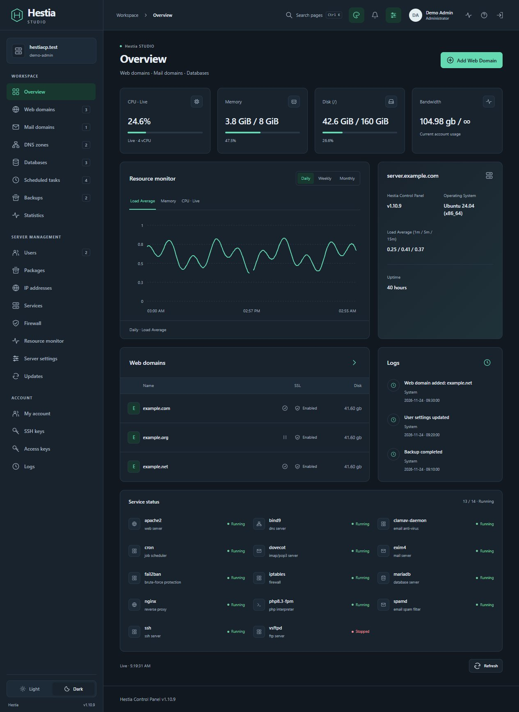
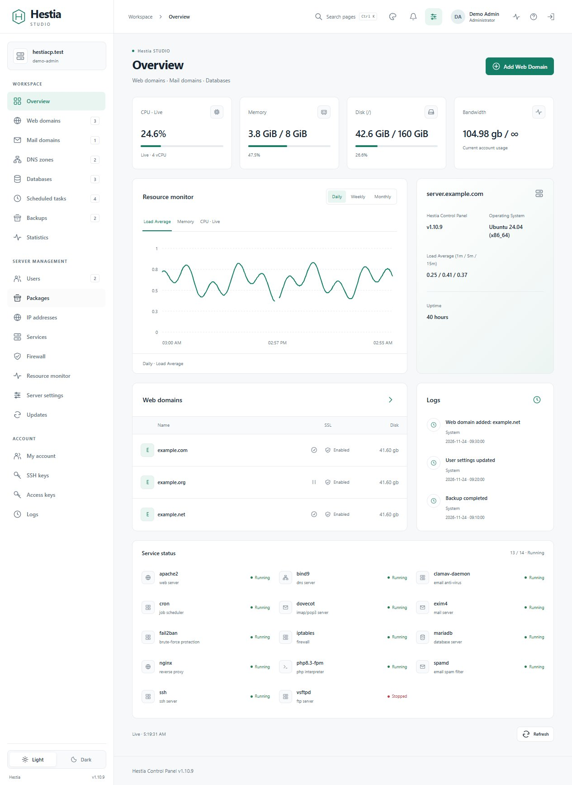
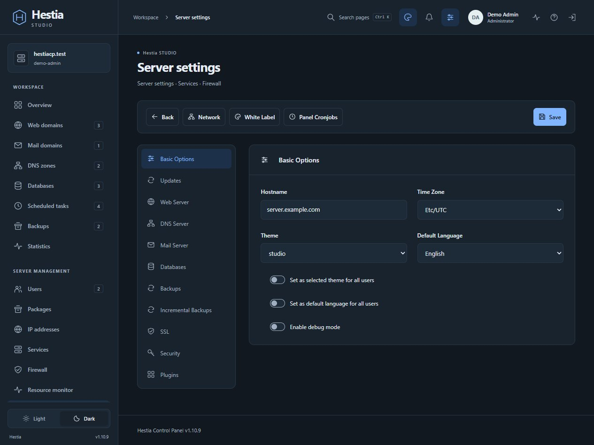
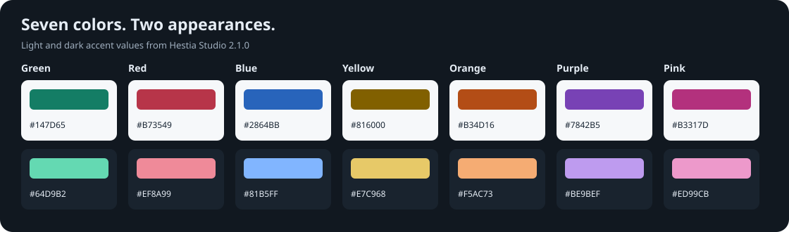

<div align="center">

# Hestia Studio

### A modern HestiaCP theme. A familiar workflow.

**Light & dark modes · 7 color palettes · 43 languages · Responsive layouts**

[Install](#installation) · [Screenshots](docs/SCREENSHOTS.md) · [Colors](#seven-color-palettes) · [Compatibility](docs/COMPATIBILITY.md) · [Contribute](CONTRIBUTING.md)

</div>



**Hestia Studio** is a free, open-source theme for **Hestia Control Panel (HestiaCP) 1.10.9**. It brings a clean sidebar, a useful server overview, and a consistent interface to everyday hosting administration.

Your existing forms, hosting modules, permissions, and backend actions continue to run through HestiaCP. Studio installs custom CSS, JavaScript, PHP presentation metadata, and language dictionaries. **No Hestia core file is patched.**

> **Compatibility:** Studio **2.1.1** targets HestiaCP **1.10.9**. The installer rejects other versions. Screenshots use fictional accounts, reserved example domains, and synthetic measurements. Read the [validation limits](docs/COMPATIBILITY.md#verification-and-limits) before deployment.

## What you get

| Feature | What it does |
| --- | --- |
| Sidebar navigation | Groups hosting, server management, and account pages; follows the current role and available modules. |
| Light and dark modes | Switch appearances from the sidebar and retain the preference in the current browser. |
| Seven accent palettes | Green, red, blue, yellow, orange, purple, and pink, each with light and dark variants. |
| Administrator overview | CPU, memory, root disk, account bandwidth, resource charts, recent domains and logs, and service status cards. |
| Native hosting workflows | Restyles user, web, DNS, mail, database, cron, package, firewall, IP, and service pages. |
| Readable statistics | Monthly disk and bandwidth cards with charts based on Hestia's actual values. |
| Organized server settings | A section menu for existing fields, preserving the original form and validation flow. |
| Quick navigation | Page search with `Ctrl+K`, breadcrumbs, SVG icons, and localized action tooltips. |
| International interface | 43 complete theme dictionaries; RTL layouts for Arabic, Persian, Sorani Kurdish, and Urdu. |
| Responsive layout | Collapsible navigation and layouts that adapt to smaller screens. |

File manager and terminal links open their respective applications; Studio does not replace those applications' interfaces.

## Screenshots

These are local renderings of native Hestia views with Studio applied. All accounts, domains, logs, and measurements shown are demonstration data.

| Light appearance | Server settings in blue |
| --- | --- |
|  |  |

Explore the [full gallery](docs/SCREENSHOTS.md) for hosting pages, statistics, services, forms, and accent colors.

## Seven color palettes

Open **Color palette** in the top bar and choose a color. Use **Light** or **Dark** in the sidebar to change the appearance. Both choices persist in the current browser. Green is the default accent; service status colors remain independent of the palette.



| Palette | Light accent | Dark accent |
| --- | --- | --- |
| Green | `#147D65` | `#64D9B2` |
| Red | `#B73549` | `#EF8A99` |
| Blue | `#2864BB` | `#81B5FF` |
| Yellow | `#816000` | `#E7C968` |
| Orange | `#B34D16` | `#F5AC73` |
| Purple | `#7842B5` | `#BE9BEF` |
| Pink | `#B3317D` | `#ED99CB` |

## Installation

**Download → extract → run the installer → select Studio for your user.**

No Node.js, npm, Python, Composer, database migration, or frontend build is needed on the Hestia server. The repository already contains the theme files.

### 1. Download and extract

Open this repository's **Releases** section and download `Hestia-Studio-Theme.tar.gz` or `Hestia-Studio-Theme.zip`. The release includes `SHA256SUMS.txt` for download verification. **Code → Download ZIP** also works, but contains the current development source. Transfer the package to your HestiaCP server and extract it outside hosted websites' public directories.

Open a terminal in the extracted folder containing `README.md`, `scripts/`, and `theme/`. For a dedicated TAR.GZ package:

```sh
tar -xzf Hestia-Studio-Theme.tar.gz
cd hestia-studio
```

A GitHub source ZIP normally extracts to `hestia-studio-main`; enter that directory instead.

### 2. Install

```sh
sudo bash scripts/install.sh
```

Already root? Use `bash scripts/install.sh`.

The installer checks HestiaCP **1.10.9**, validates PHP and all 43 dictionaries, backs up existing Studio assets, and installs **46 theme files**. Keep the backup directory printed at completion. It does not restart services or change the selected theme.

### 3. Select Studio for your account

1. Sign in and open **your own user profile / Edit User**.
2. Find **Theme**, select **`studio`**, and save.
3. Reload. If the old appearance remains, hard-refresh with **Ctrl+Shift+R** on Windows/Linux or **Cmd+Shift+R** on macOS.

**The server default and the user's theme preference are separate.** Administrators can also choose `studio` in **Server settings → Basic Options → Theme**, but an existing user's saved preference may still take precedence. If the server setting changed and your screen did not, select `studio` in your own account's **Theme** field too.

Choose **Set as selected theme for all users** only if you intentionally want to change everyone's appearance. It is not required for your own account.

Read the [detailed installation guide](docs/INSTALLATION.md) for updates, rollback, removal, and troubleshooting.

## Update, rollback & remove

**Update:** extract the newer package and run `sudo bash scripts/install.sh` again. An account already using `studio` only needs a reload.

**Roll back:** use the backup printed by the Studio installer:

```sh
sudo bash scripts/restore.sh /usr/local/hestia/data/studio-backups/BACKUP_DIRECTORY
```

**Remove:** first switch affected users and the server default to another installed theme, then log out of existing Studio sessions. Run:

```sh
sudo bash scripts/uninstall.sh
```

Only Studio's known assets are removed; installer backups are retained.

## How it works

| Source | Installed location |
| --- | --- |
| `theme/studio.css` | `/usr/local/hestia/web/css/themes/custom/studio.css` |
| `theme/studio.js` | `/usr/local/hestia/web/js/custom_scripts/studio.js` |
| `theme/studio.php` | `/usr/local/hestia/web/js/custom_scripts/studio.php` |
| `theme/locales/*.json` | `/usr/local/hestia/web/js/custom_scripts/studio-locales/` |

Studio uses Hestia's custom theme directory and existing custom-script loader. Native templates, authentication, controllers, field names, submit targets, permissions, and CSRF handling stay in place. This is an independent community theme, not an official HestiaCP product.

The administrator overview reads authorized, same-origin Hestia pages and RRD data. Host metrics refresh every 30 seconds while the page is visible. The PHP component reads Linux CPU ticks, memory, and root-filesystem space only in the permitted administrator overview. It executes no shell commands and creates no new endpoint.

**CPU percentage is a live sample.** Historical charts show load average or used memory; load average is not labeled historical CPU percentage. HestiaCP 1.10.9 exports load multiplied by 100; Studio converts that series back to load units (raw `105` becomes `1.05`). Memory history remains in MiB and live CPU remains a percentage. Missing samples remain gaps, including when the process-count column is present; zero remains valid. Root-filesystem disk and account bandwidth have different scopes.

Theme translations, layout direction, and number/date formatting follow the effective account language supplied by the PHP bridge. A different server-default HTML language does not override it. Empty account language uses the server default; invalid or unavailable dictionaries retain the existing gettext/English label fallback and use English formatting. The browser's presentation language is updated without changing account or server preferences.

The profile uses the current account's Contact Name, falling back to the username. An administrator's first plain Users page after login opens Overview; later Users visits, deep links, POST requests, and impersonated sessions keep their normal behavior.

## Privacy & security

The installed theme requires no analytics, tracking service, CDN, remote font, or external translation service. Appearance preferences remain in localStorage; dashboard requests stay on the panel's origin and use the signed-in session.

Examples use fictional values. Local review fixtures, environment files, keys, and generated archives are excluded from the source publication list. A [publication check](docs/PRIVACY.md) scans approved files and release contents before distribution. It is an additional safeguard, not a guarantee against every secret or vulnerability.

Read [SECURITY.md](SECURITY.md) before reporting a vulnerability. Never post credentials or unredacted production screenshots in an issue.

## Development

Use **Node.js 20+**, **PHP 8+**, and **Python 3.10+**. No npm dependencies need installation.

```sh
npm run check
npm run build
python scripts/package.py
```

- `theme/` is the installable theme.
- `dist/` is the original interactive prototype with fictional in-memory data. Its controls do not administer a server; some prototype text is Turkish. It is separate from the multilingual native theme.
- `npm run build` creates the offline prototype in `release/`.
- Packaging uses explicit file lists, verifies content, normalizes archive ownership metadata, and creates SHA-256 checksums.
- `npm run dev` serves the prototype locally.

**Verified on Ubuntu 24.04 with HestiaCP 1.10.9:** the maintainer confirmed installation of 2.1.0 from the public GitHub source ZIP, an exact match for all 46 installed theme files, restoration using the first-install backup, and reinstallation. Installation from the published GitHub Release and ongoing use were also confirmed. Turkish display, palette changes, light/dark switching, the mobile menu, and opening server settings were checked.

This is a limited installation and interface check, not a comprehensive production test. User creation, service restarts, SSL issuance, mail delivery, and all administration operations were not verified. Restoring a first-install backup does not verify rollback to an older Studio version after an upgrade. The 2.1.1 load-scale and account-language fixes have local automated regression coverage; those fixes still need a targeted Linux/browser check after installation. See [compatibility and testing](docs/COMPATIBILITY.md).

## Contribute

Bug reports, translations, accessibility improvements, and focused pull requests are welcome. Start with [CONTRIBUTING.md](CONTRIBUTING.md) and the [translation guide](docs/TRANSLATING.md).

Use **Discussions** for questions and community ideas, and **Issues** for reproducible bugs and focused feature requests. See [support options](SUPPORT.md) and our [code of conduct](CODE_OF_CONDUCT.md). Fork the repository and open a pull request to contribute; maintainers review changes before merging them.

## License & credits

[GPL-3.0-or-later](LICENSE). HestiaCP translations and bundled third-party code retain attribution in [THIRD_PARTY_NOTICES.md](THIRD_PARTY_NOTICES.md).

Built for the [Hestia Control Panel](https://hestiacp.com/) community. See Hestia's [customisation documentation](https://hestiacp.com/docs/server-administration/customisation) for the underlying custom-theme mechanism.
