# Hestia Studio screenshot gallery

All screenshots show **native HestiaCP views rendered locally with synthetic data**. Accounts, domains, addresses, logs, and resource measurements are fictional; they do not describe a production server. The gallery is separate from the original standalone `dist/` prototype.

## Server overview

Live CPU, memory, root disk, account bandwidth, load/memory charts, recent domains, logs, and compact service cards.

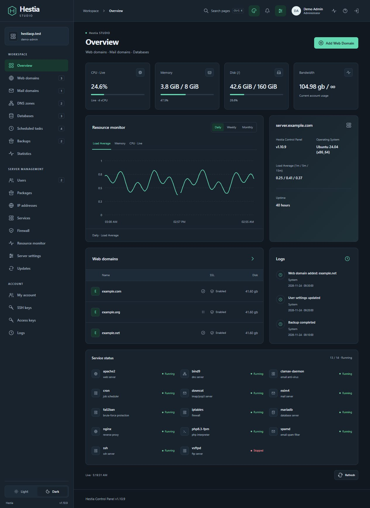

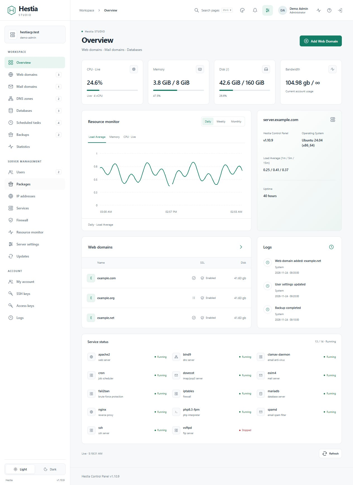

## Seven accent palettes

The chart uses the exact values from `theme/studio.css`. Each palette has a light and dark variant. Status colors remain independent.

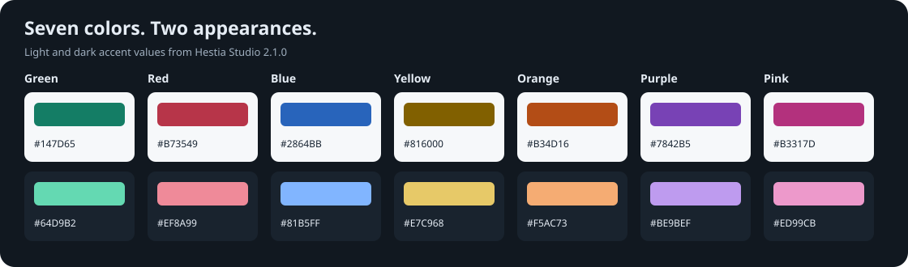

| Red | Blue |
| --- | --- |
| 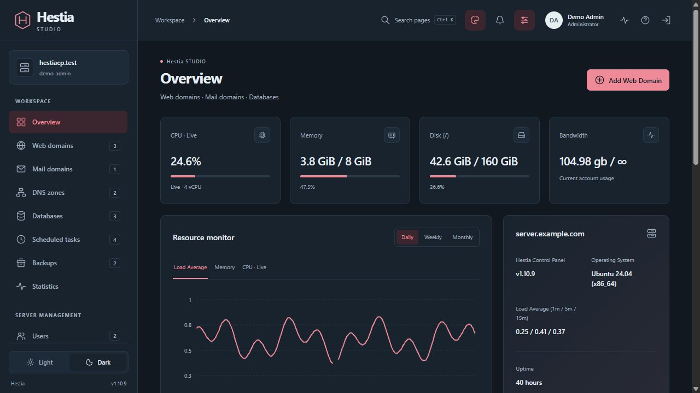 | 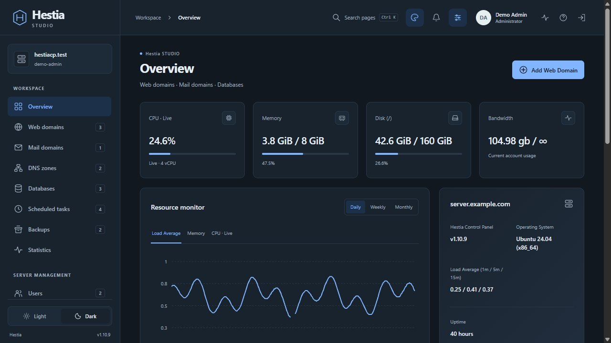 |

| Yellow | Orange |
| --- | --- |
|  | 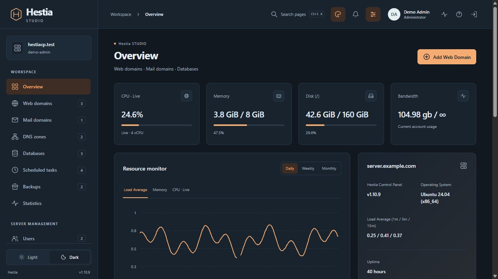 |

| Purple | Pink |
| --- | --- |
| 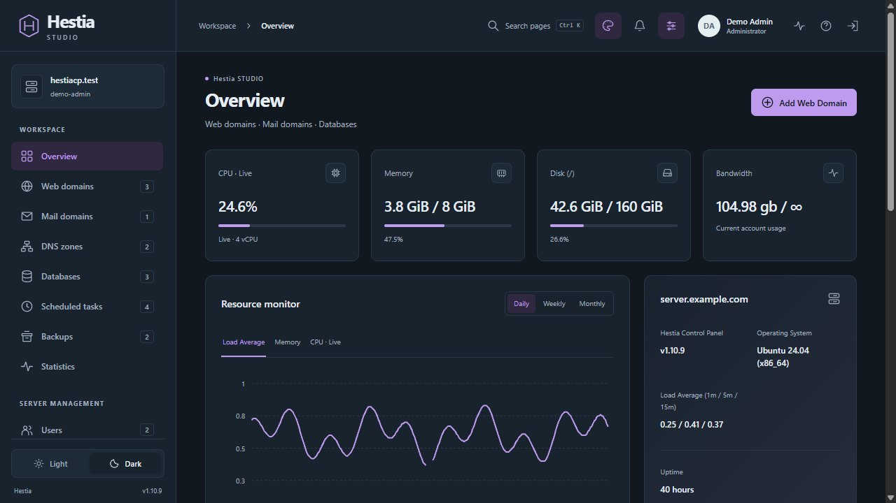 | 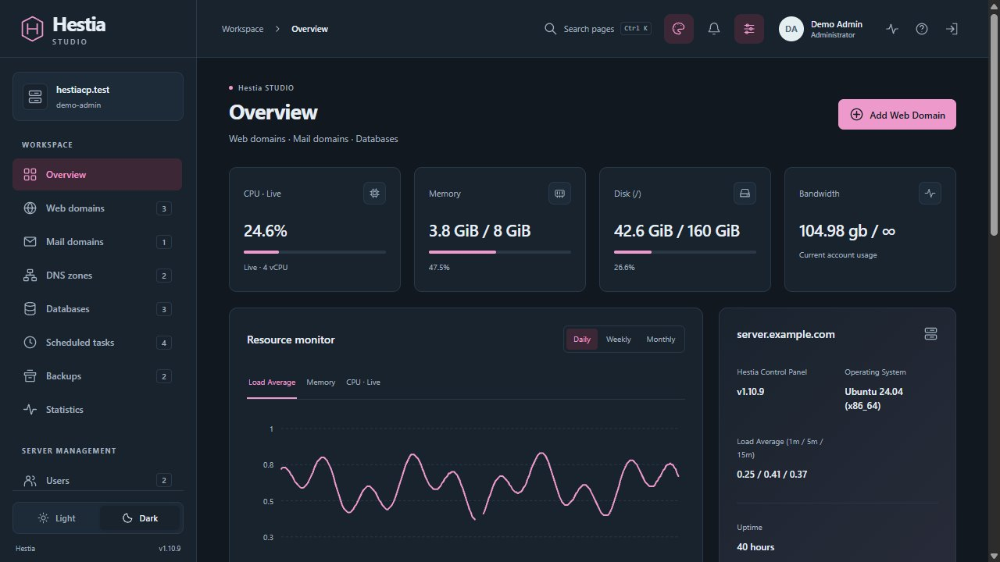 |

The green default is shown in the overview screenshots above.

## Server settings

Native fields remain inside their original form. The section menu organizes configuration without introducing a second settings backend.

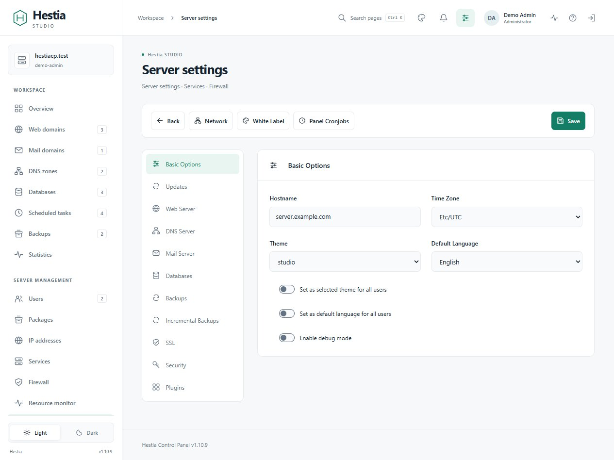

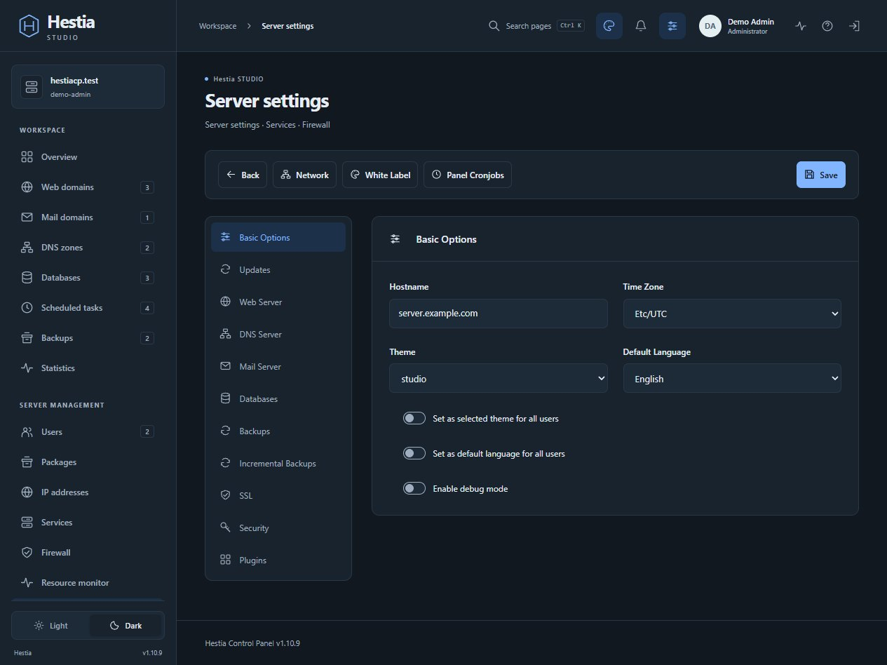

## Web domains

Native domain actions, status indicators, selection, sorting, and search.

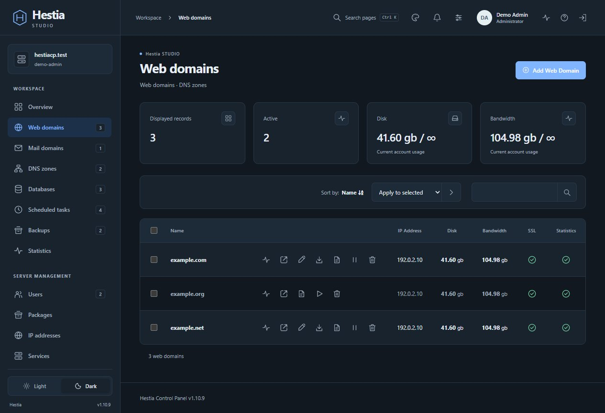

## Monthly statistics

Disk and bandwidth cards and charts based on the native monthly records.

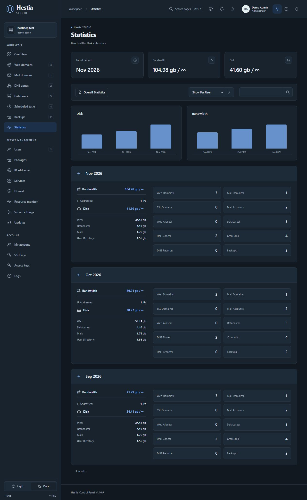

## Services

The original service table and controls remain available. No service action was executed for these screenshots.

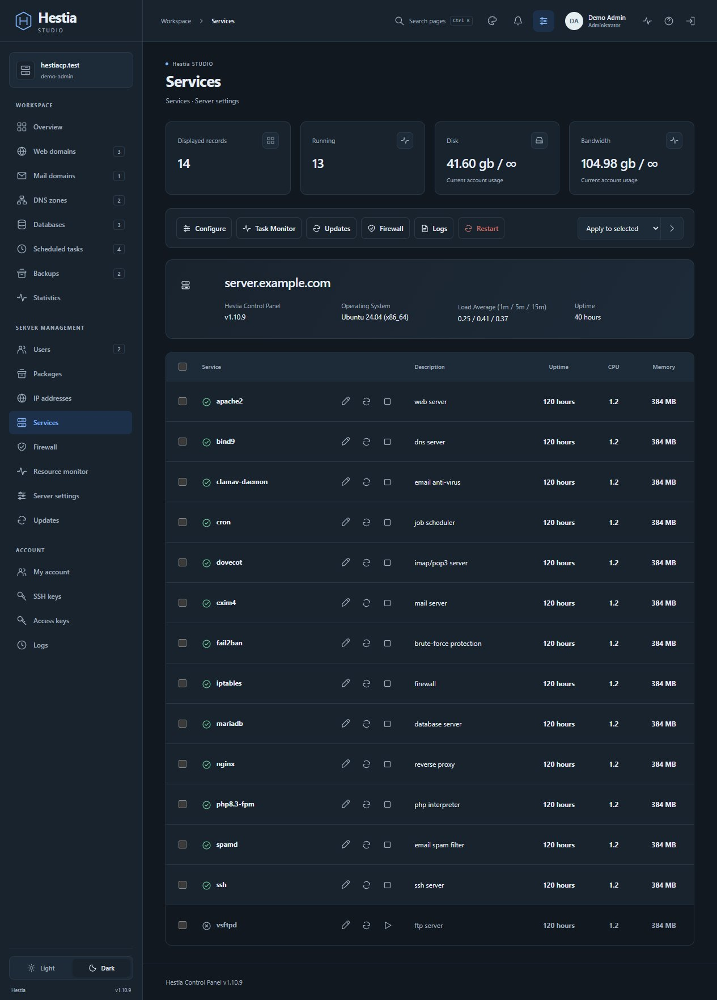

## User forms

Consistent native controls and account preferences. The user-level **Theme** field is separate from the server default; see the [installation guide](INSTALLATION.md#activate-it-account-theme-versus-server-default).

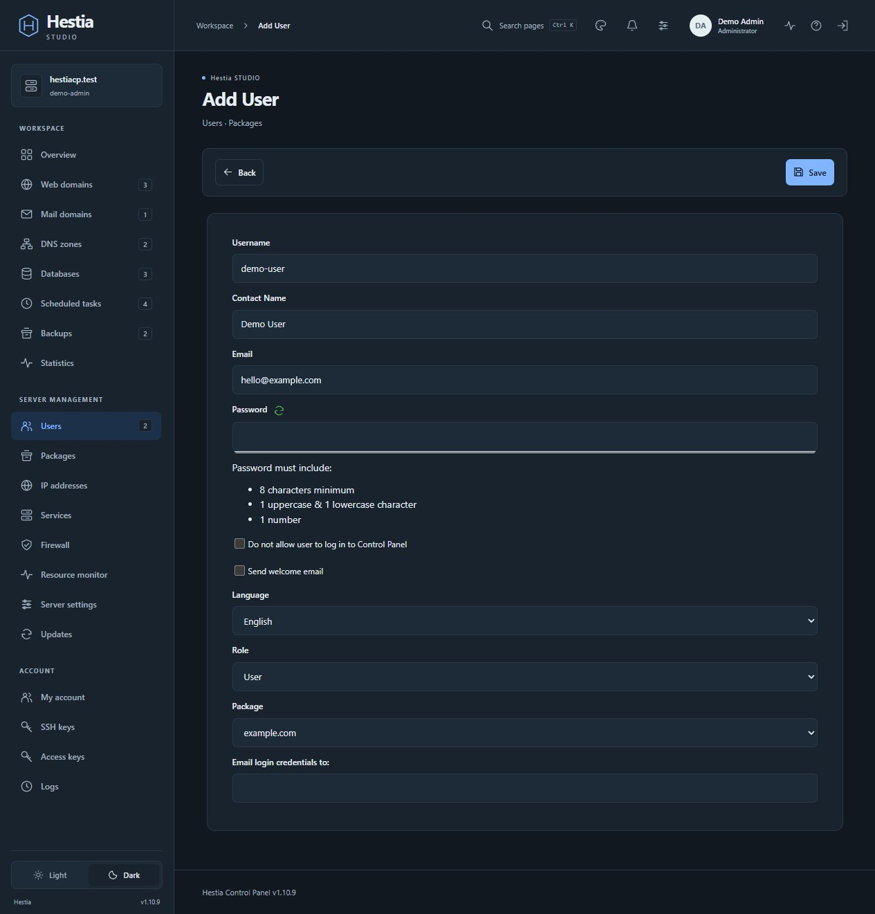

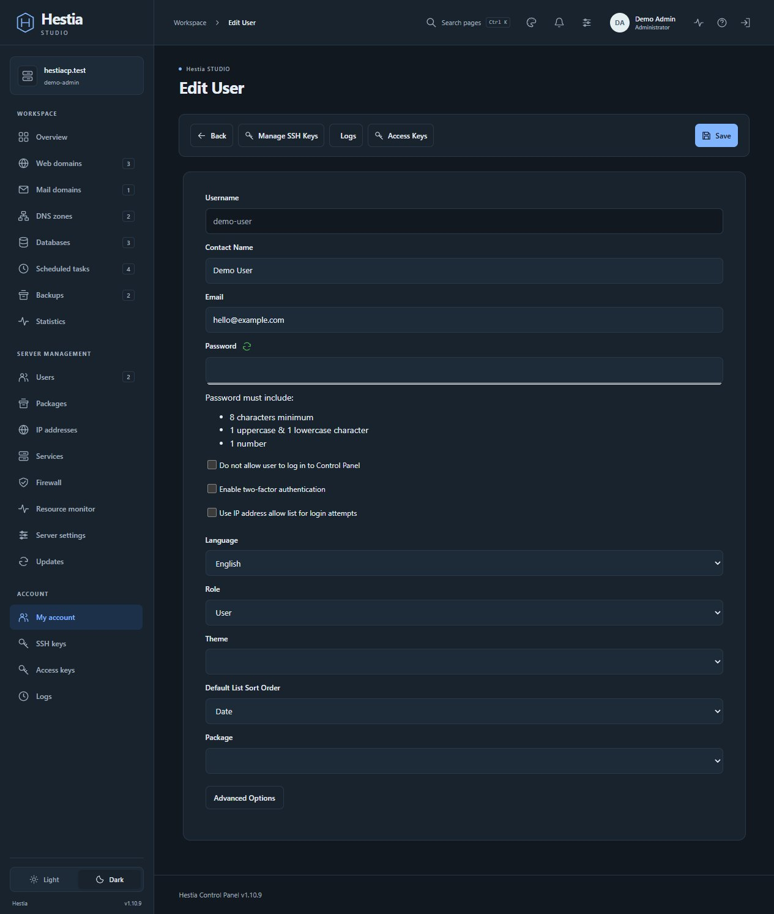
